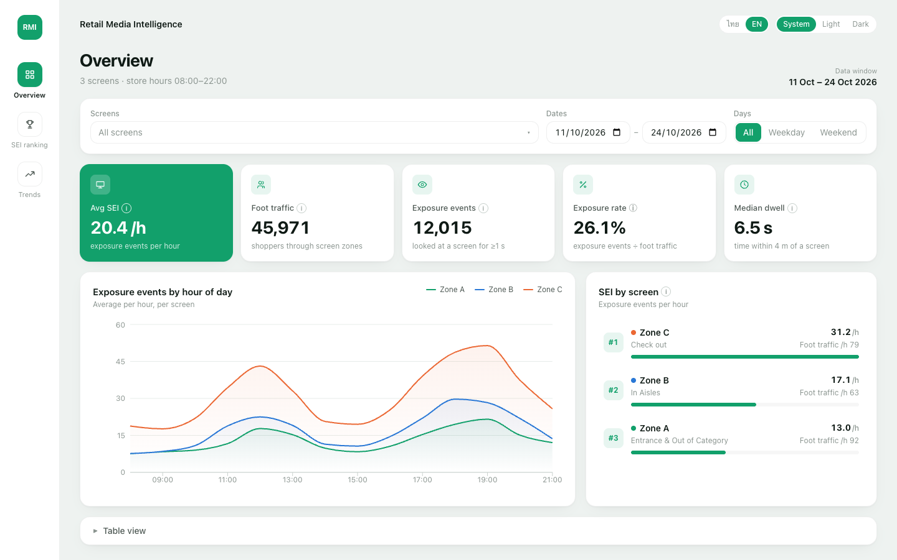
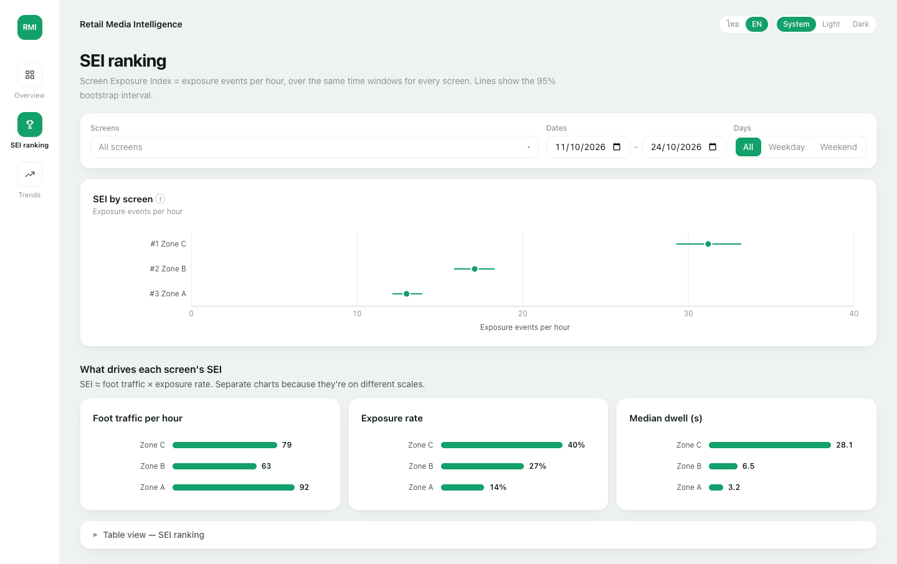
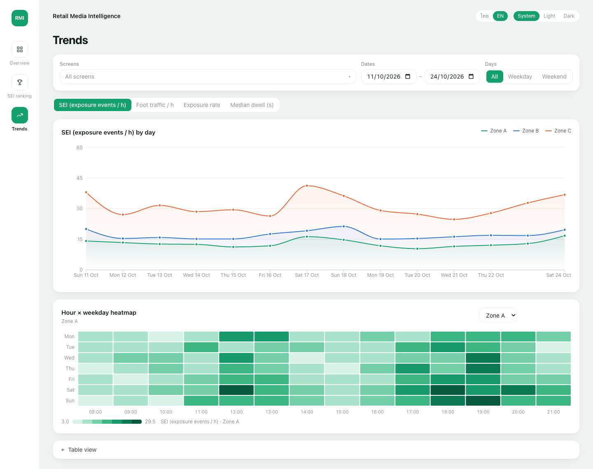
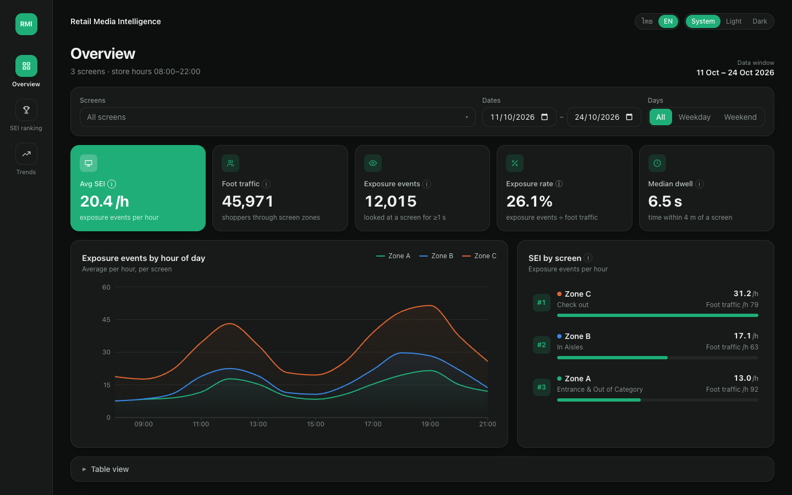
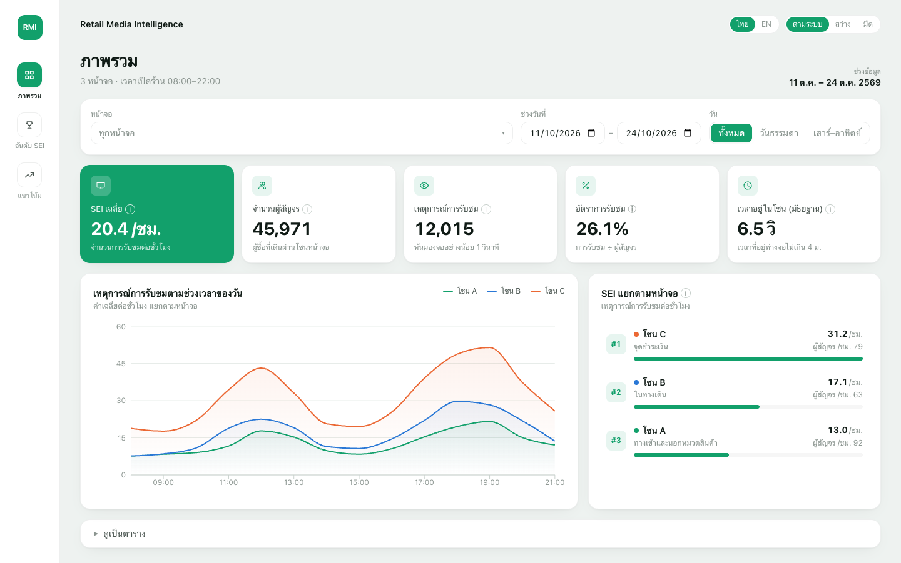
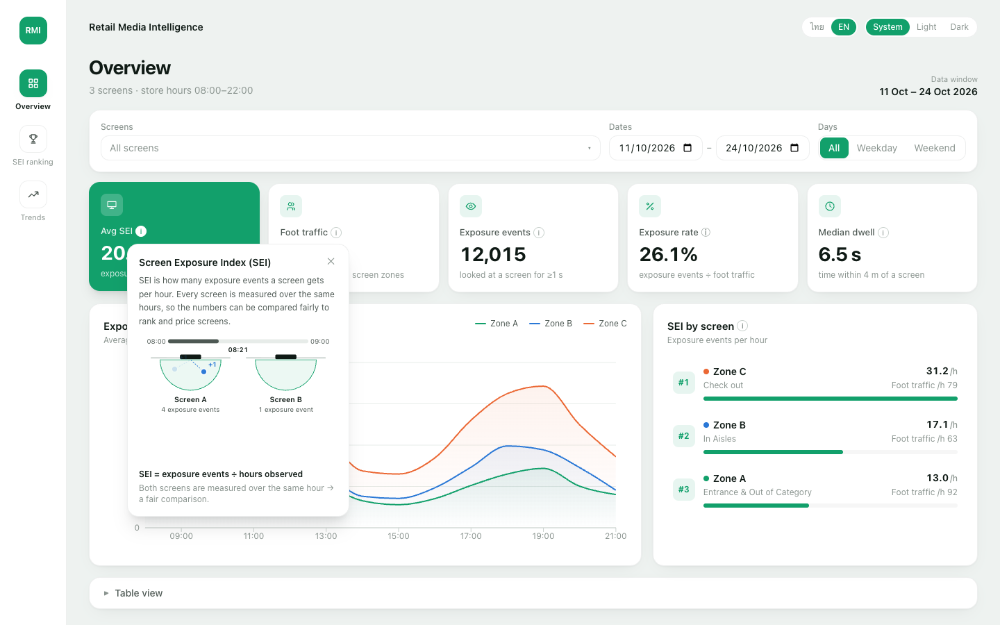
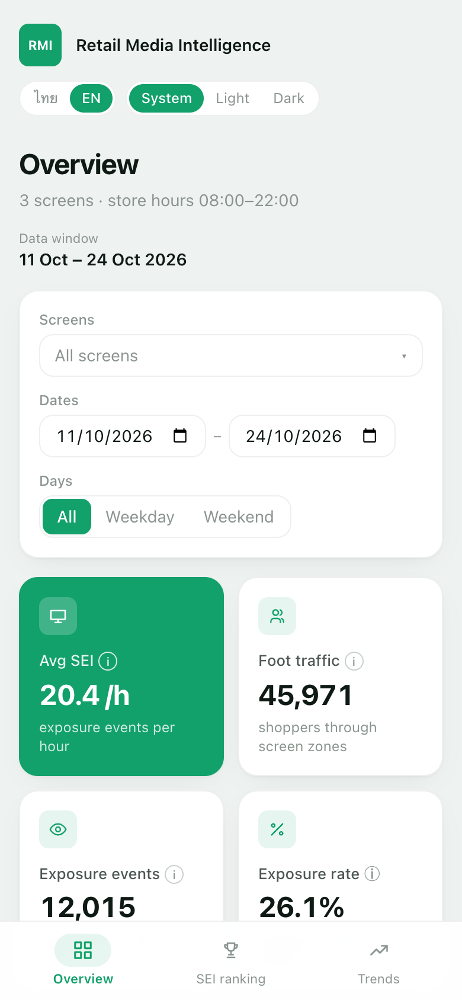
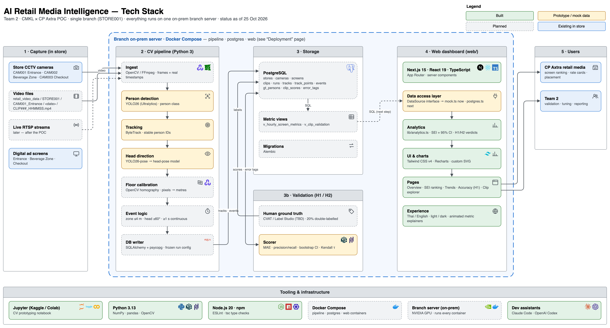

# AI Retail Media Intelligence — POC

Measure in-store ad-screen reach from existing CCTV: foot traffic, dwell time and
exposure events, rolled up into a Screen Exposure Index (SEI) per screen, and
validated against blind human labels (H1 accuracy, H2 screen ranking).

## Screenshots

Dashboard on mock data (Next.js, English / Thai, light / dark).



| SEI ranking | Trends |
|---|---|
|  |  |

| Dark mode | Thai |
|---|---|
|  |  |

| Animated explainer (tap any ⓘ) | Phone |
|---|---|
|  |  |

## Architecture



More in [architecture/](architecture/README.md) — including the deployment diagram (one on-prem server per branch).

## Repository layout

```
docs/           Guides (sei-guide.md — how to read SEI, EN/TH) and UI screenshots
architecture/   Tech stack + deployment diagram (tech-stack.drawio — open in draw.io)
notebooks/      Prototyping notebooks (YOLO detection + pose → footfall / dwell / facing)
schema/         PostgreSQL schema.sql, seed.sql and ER diagram (er-diagram.drawio)
web/            Next.js dashboard (currently on mock data)
```

Planned, not built yet: `pipeline/` — CV pipeline: detect → track → events → PostgreSQL.

## Run the dashboard

```bash
cd web
npm install        # first time only
npm run dev        # http://localhost:3000
```

See [web/README.md](web/README.md) for the code structure and how to plug in Postgres.

## Metric definitions (from the proposal)

| Metric | Definition |
|---|---|
| Foot traffic | Shoppers passing through the screen zone per hour |
| Dwell time | Seconds a shopper spends within ≤4 m of the screen |
| Exposure event | In zone (≤4 m), head within ±60° of the screen, for ≥1 continuous second |
| Exposure rate | Exposure events ÷ foot traffic |
| SEI | Exposure events per hour, per screen, over identical time windows |
