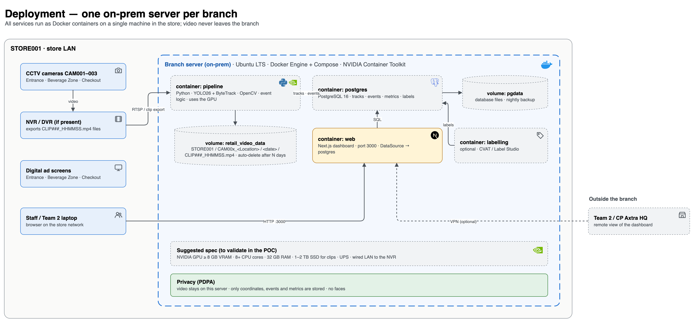

# Architecture

`tech-stack.png` and `deployment.png` are PNG exports of the two pages of `tech-stack.drawio`
(re-export them after editing the diagram).

- `tech-stack.drawio` — two pages (tabs at the bottom in draw.io):
  - **Tech stack** — data flow from capture to dashboard, colour-coded by status
    (green = built, amber = prototype / mock data, grey dashed = planned, blue = existing in store).
    The dashed blue frame marks what runs on the branch server.
  - **Deployment** — one on-prem server per branch running everything in Docker Compose
    (pipeline on the GPU, postgres, web, optional labelling tool), its volumes, store-LAN access,
    optional VPN for remote viewing, a suggested hardware spec and the PDPA note.

Open and edit it with any of:

- draw.io desktop app (https://www.drawio.com) — File → Open
- VS Code extension "Draw.io Integration" (hediet.vscode-drawio) — just open the file
- app.diagrams.net — File → Open from → Device

Export from draw.io with File → Export as → PNG / SVG / PDF for slides and the report.

Icons are embedded in the file (works offline) and are grouped with their box, so they move together.
Brand logos come from [Simple Icons](https://simpleicons.org) (CC0; logos remain trademarks of their
owners). Concepts without a logo (camera, clips, ad screen, map, tracking, users…) use simple
line pictograms. To swap an icon in draw.io: select it → Edit Style, or delete it and drag in one from
the shape library (search e.g. "camera").
